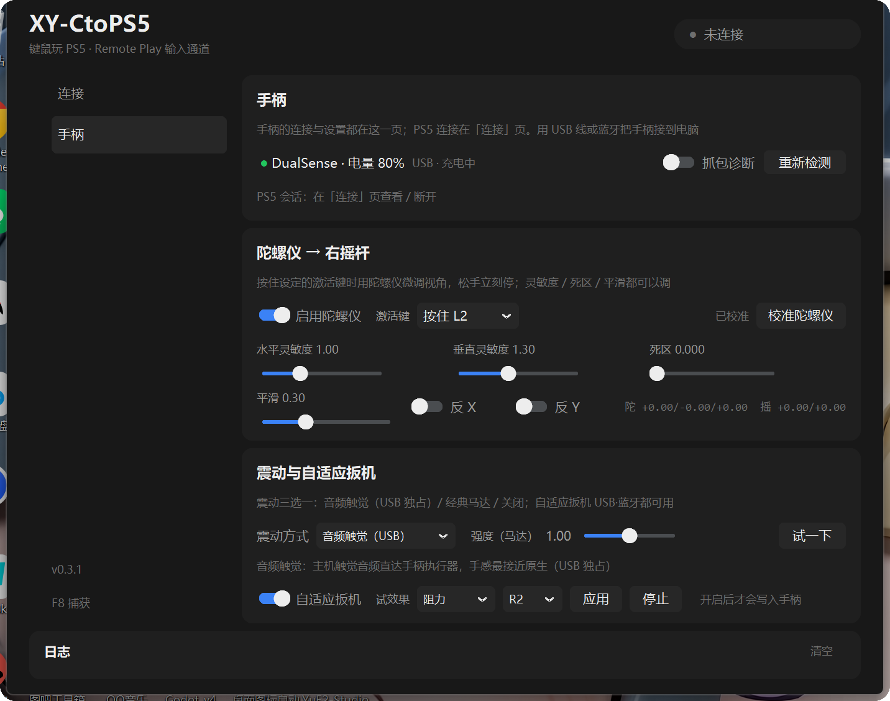
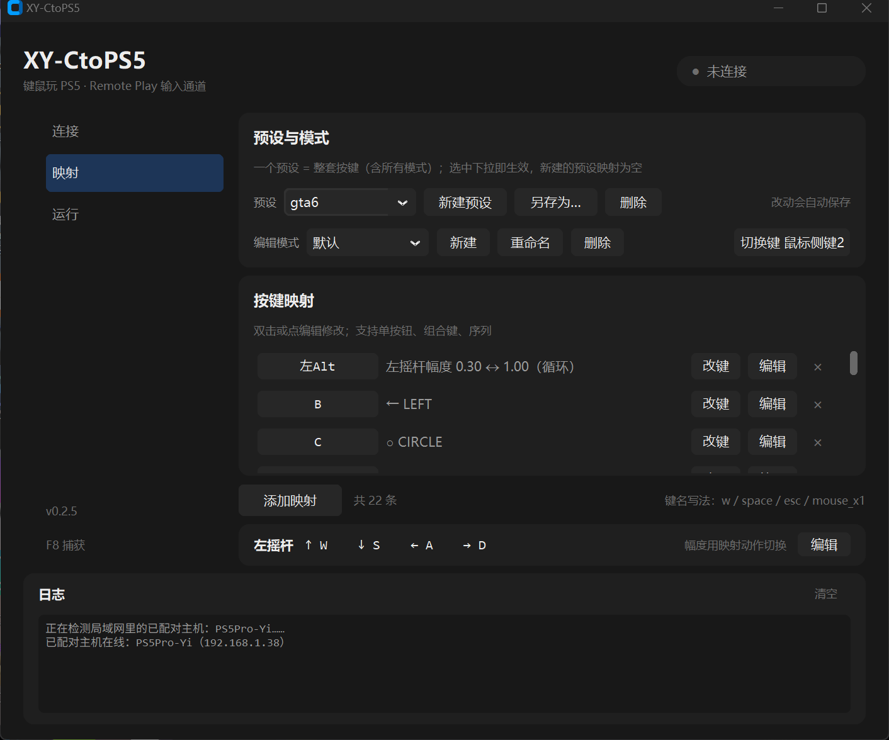
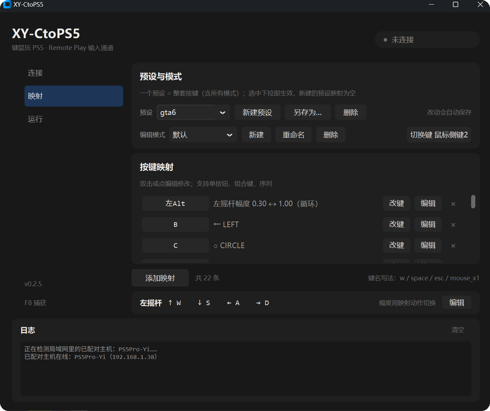

# XY-CtoPS5

> 把 PC 的**键鼠**或 **DualSense 手柄**变成 PS5 的输入，通过 Remote Play 通道发送。
> Use your PC **keyboard & mouse** or a **DualSense controller** as PS5 input over Remote Play.

[](LICENSE)


配合采集卡（HDMI 环出）看画面，就能用键鼠玩 PS5 单机游戏——画面走采集卡几乎零延迟，输入走 Remote Play 协议。

**中文文档** | [English](#english)

## 两种玩法（平级）

| 玩法 | 输入 | 适合 |
|---|---|---|
| **键鼠玩法** | 键盘映射手柄按键 + 鼠标→右摇杆（Raw Input / Flick Stick / 两段灵敏度） | 射击、需要精细瞄准的游戏 |
| **手柄玩法** | DualSense 直通（蓝牙 / USB）：按键、摇杆、扳机模拟量 | 想用真手柄手感、要陀螺仪/自适应扳机的游戏 |

连接页选择玩法，连接成功后只显示对应页签。详见 [CHANGELOG](CHANGELOG.md) 与 [0.3.0 更新说明](docs/release-0.3.0.md)。

---

# 中文文档

## 这是什么

PS5 主机**不直接支持键盘鼠标**。本工具在 PC 上建立一条 Remote Play 输入通道，把键鼠事件模拟成 DualShock 4 的手柄输入发给 PS5。

画面通过采集卡（如 GC553G2B）的 HDMI 环出显示在 PC 上，延迟远低于串流。最终体验：**看着采集卡画面，用键鼠打 PS5 游戏**。

> 本项目最初是为《GTA6》单机战役做的键鼠方案。鼠标→右摇杆的算法参考了业界公开实现（chiaki / JoyShockMapper / DS4Windows）的做法。

---

## 功能特性

### 手柄玩法：DualSense 直通 + 陀螺仪



| 能力 | 说明 |
|---|---|
| **DualSense 直通** | 蓝牙 / USB 均可；按键、摇杆、L2/R2 模拟量原样发给主机 |
| **陀螺仪 → 右摇杆** | 按住激活键（默认 L2，可改任意键）时用体感微调视角，松手立刻停 |
| **陀螺仪调校** | 水平/垂直灵敏度、死区、平滑、反 X / 反 Y；roll 方向已按实机校正 |
| **自动校准** | 手柄平放稳定 3 秒自动完成并关闭，显示质量（优 / 良 / 一般） |
| **自适应扳机（主机下发）** | 开枪（0x25）、发动（0x21）、开车油门/刹车（wire 0x05 → 0x21）实机验证；游戏驱动，无需配置 |
| **扳机本地测试** | 阻力 / 开枪 / 震动 / 拉弓四种效果 + 强度档位 + 停止 |
| **USB 原生触觉（实验性）** | 解码主机 haptics 音频写入 DualSense 3/4 声道，默认关闭、手感待标定 |
| **主机与手柄状态** | 电量 / 充电 / 蓝牙·USB；未连接时给出配对提示；手柄玩法下可直接唤醒主机 |

### 鼠标 → 右摇杆



| 特性 | 说明 |
|---|---|
| **Raw Input 设备位移** | 直接读鼠标设备报文，不依赖光标坐标，不受窗口焦点影响 |
| **固定时间窗口换算** | 10ms 窗口累积位移再算速度，避免帧间抖动 |
| **反死区 Anti-Deadzone** | 非零输入抬升到阈值以上，解决"小幅移动拖不动"（游戏自身摇杆死区会吃掉小值） |
| **两段灵敏度** | 慢转 / 快转分别设灵敏度，中间线性过渡（精细瞄准 + 快速转身） |
| **Flick Stick** | 水平快速甩动时摇杆瞬间满偏一小段，模拟瞬间转身（Jibb Smart 方案） |
| **响应曲线** | 线性 / 二次 / 三次 / 幂，四种可选 |
| **输入死区 + 平滑 + 总开关** | 全部可实时调，改完即存 |

### 键盘 → 手柄



- 任意键映射任意手柄按钮（含组合键、序列宏、摇杆幅度档位）
- **多模式**：每个模式一套完整映射，一个键循环切换（默认 / 驾驶）
- **左摇杆方向键**：WASD 推摇杆，支持过渡速度（短按小幅、长按满幅）

### 其他

- **已配对主机一键连接**：记住上次配对的主机，启动时自动检测它是否在当前局域网；
  在线就停在快捷页点「直接连接」，不在线自动回到完整连接流程
- **透明置顶覆盖层**：捕获时抢焦点、隐藏鼠标指针、右上角短暂显示模式名 / 扳机深度
- **扳机深度**：L2 / R2 可设定按压深度（走 Remote Play 的 analog button 事件），滚轮 / 键盘 / 滑条都能调
- **目标窗口**：开始捕获时自动把焦点切到指定窗口
- **手感参数独立保存**：摇杆参数存 `tuning.json`，应用预设不会覆盖

---

## 系统要求

- Windows 10 / 11
- PS5 已开启远程游玩
- Python 3.12（仅源码运行需要）
- 采集卡（推荐；不接也能用但看不到画面）

---

## 快速开始

### 1. 安装

**方式 A：安装包（推荐）**

1. 下载 `XY-CtoPS5-win64.zip` 并**完整解压**
2. 进入 `XY-CtoPS5-Setup\`，双击 `XY-CtoPS5-Setup.exe`
3. 安装程序会复制到 `%LOCALAPPDATA%\XY-CtoPS5` 并创建桌面快捷方式

**方式 B：源码运行（开发版）**

```powershell
# 双击 install-dev.cmd，或：
powershell -ExecutionPolicy Bypass -File .\install.ps1
.venv\Scripts\pythonw.exe launch.pyw
```

### 2. 开启 PS5 远程游玩

PS5 上：**设置 → 系统 → 远程游玩 → 启用远程游玩**

### 3. 准备 PS5 画面

把 PS5 的 HDMI 输出接到采集卡，在 OBS / 采集卡软件里预览。

### 4. 配对 PS5（只需一次）

见下方「使用教程」第 2 步。

### 5. 连接并开始捕获

1. 打开 XY-CtoPS5 → 「连接」页
2. **第一次用**：按上面第 4 步完成配对，然后点 **连接主机**
3. **之后每次**：启动程序会自动检测已配对的主机，在线时点 **直接连接** 即可，不用再填任何东西；
   要换主机或换 PSN 账号，点 **换 ID 连接** 回到完整流程
4. 点 **开始捕获**（或按 **F8**），切到采集卡窗口，用键鼠控制 PS5

---

## 使用教程

### 第 1 步：获取 PSN Account ID

Remote Play 配对需要你的 **PSN 账号 ID**（64 位数字，通常以 Base64 字符串表示，例如 `57e082umn2c=`）。

获取方式（任选其一）：

**方法 A：第三方 PSN 查询网站（最简单）**

1. 打开 PSN 账号信息查询站点（如 `psn.flipscreen.pro` 一类工具）
2. 输入你的 **PSN 在线 ID**（游戏里显示的名字）
3. 得到形如 `xxxxxxxxxxxxxxx=` 的 **Account ID（Base64）**

> 第三方站点与本项目无关，请自行判断安全性。它只做公开信息查询。

**方法 B：从已有工具获取**

如果你用过其他 Remote Play 工具（如 chiaki），它保存的配置里就有 `account_id`，可以直接复用。

**方法 C：Base64 转换**

如果你拿到的是十进制账号 ID（纯数字），程序也支持——配对页直接填十进制也能识别，会自动转成 Base64。

### 第 2 步：获取 PS5 的 PIN

1. PS5 上打开 **设置 → 系统 → 远程游玩**
2. 确认「**启用远程游玩**」已打开
3. 点击「**关联设备**」（Add Device / Register Device）
4. PS5 屏幕会显示 **8 位数字 PIN**

> PIN 是一次性的，只在配对界面存在时有效。配对成功后不需要再输入。

### 第 3 步：在程序里配对

1. 打开 XY-CtoPS5 → 「连接」页
2. 填入：
   - **PS5 IP**：PS5 的局域网 IP（PS5：设置 → 网络 → 查看连接状态 里能看到）
   - **Account ID**：第 1 步拿到的 Base64
   - **PIN**：第 2 步 PS5 屏幕显示的 8 位数字
3. 点「**配对**」
4. 成功后生成 `credentials.json`，以后不用再配对

### 第 4 步：连接与捕获

1. 「连接」页 → **连接主机**（已配对过时是 **直接连接**）
   - 程序启动时会自动检测已配对主机在不在当前局域网；
   - 在线：快捷页点「直接连接」；不在线：自动回到完整流程，按提示重试或重新配对
2. 状态变成"已连接"后 → 「运行」页 → **开始捕获**（或 F8）
3. 切到采集卡预览窗口，用键鼠操作 PS5

**注意**：PS5 同一时间只允许**一个** Remote Play 会话。如果提示"主机被占用"，说明 PS5 上还挂着别的会话——在 PS5 上关掉再打开「启用远程游玩」，或重启主机。

### 第 5 步：调整鼠标手感

运行页有一整排滑条，全部**实时生效、松手即存**：

| 滑条 | 作用 | 建议 |
|---|---|---|
| **过渡** | 左摇杆推出速度（WASD） | 4.0/s；想转向更细腻就调小 |
| **死区** | 输入死区 | 0 ~ 0.01，太大会导致小移动无响应 |
| **灵敏度** | 全局放大倍数 | 1.8 左右 |
| **慢灵敏** | 小幅度移动的倍率 | 1.3（瞄准精度） |
| **快灵敏** | 快速甩动的倍率 | 1.8（转身速度） |
| **平滑** | 一阶平滑 | 0.3 ~ 0.5，越大越顺但延迟增加 |
| **R2 / L2** | 扳机按下深度 | 1.0 = 满按 |
| **曲线** | 响应曲线类型 | 线性最直观 |

**Flick Stick 开关**：打开后水平快速甩鼠标会瞬间转身。觉得"轻甩就转"就把 `tuning.json` 里的 `flick_threshold` 调大，转得太多就调小 `flick_duration`。

**参数存在哪**：`config.json` 存键位映射，`tuning.json` 存手感参数。应用预设只改键位，不动手感。

### 第 6 步：调整按键映射

1. 「映射」页 → 顶部「预设」下拉：**选中哪个就立即套用**，不需要再点应用
2. **新建预设**：输入名字，得到一套空映射（只有一个「默认」模式），适合新游戏从零配；
   自己新建的预设会自动保存每次修改
3. **另存为…**：把当前整套配置复制成一个新预设；**删除** 只删自己新建的（内置 gta6 不能删）
4. 「编辑模式」下拉选要改的模式（默认 / 驾驶）
5. **添加映射** → 弹出捕获框 → 按你要绑的键 → 选动作类型
6. 每条映射右侧：**改键**（换来源键，动作不变）、**编辑**（换动作）、**×**（删除）
7. 左摇杆方向键：点「编辑」单独设置

**多模式切换键**：映射页那行「切换键」按钮可以改，默认是鼠标侧键 2。捕获中按它会循环切换模式，右上角会短暂显示当前模式名。

### 第 7 步：调整扳机深度

**R2**：鼠标滚轮上下调（每格 0.1），或运行页滑条。
**L2**：键盘 `-` / `=` 调整，或运行页滑条。

运行页每行扳机右侧显示当前的"加深 / 减浅"键（默认 `↑ 滚轮上`、`↓ 滚轮下`、`↑ =`、`↓ -`），
点一下就重新捕获：可以改成任意键盘键、鼠标键（含侧键）或滚轮。

调好之后，**只有按下对应扳机时**才按这个深度输出，松开归零。想恢复满按就把值调到 1.0。

---

## 默认按键映射（GTA6）

| 输入 | 动作 | 输入 | 动作 |
|---|---|---|---|
| WASD | 左摇杆 | 鼠标移动 | 右摇杆（视角） |
| 空格 | ✕ CROSS | 鼠标左键 | R2 |
| R | □ SQUARE | 鼠标右键 | L2 |
| Q | R1 | 鼠标中键 | R3 |
| C | ○ CIRCLE | 鼠标侧键 1 | 十字键上 |
| F | △ TRIANGLE | Tab | L1 |
| Shift | L3 | Esc | OPTIONS |
| Ctrl | 十字键右 | M | 触摸板 |
| B | 十字键左 | V | 十字键下 |
| 方向键 | 十字键 | CapsLock | 同时按 L3+R3 |

- **模式切换**：鼠标侧键 2
- **驾驶模式**：W/S 变油门刹车（R2/L2）

---

## 采集卡设置建议

- 采集卡用 **HDMI 环出**接 PS5，PC 上看预览
- 分辨率 / 帧率选 1080p60 即可
- **不要在 PC 上开官方「PS Remote Play」客户端**——它会占掉唯一的 Remote Play 会话，导致本程序连不上

---

## 常见问题

**Q：连接时提示「另一台设备在用 Remote Play」/ 主机被占用？**
PS5 同一时间只允许一个 Remote Play 会话。在 PS5 上：设置 → 系统 → 远程游玩 → 关闭再打开「启用远程游玩」，或重启主机。

**Q：鼠标小幅移动没反应 / 拖不动？**
调大 `anti_deadzone`（0.15 → 0.2~0.25），或调高「慢灵敏」。游戏自身的摇杆死区会吃掉小输出。

**Q：视角自己漂？**
确认「死区」不要为 0（0.005~0.01），鼠标静止时的传感器抖动会被死区吃掉。

**Q：通过 ToDesk 等远程桌面操作时鼠标不对？**
远程桌面用绝对坐标注入鼠标，光标会撞屏幕边缘。建议把 ToDesk 的鼠标模式改成「相对 / 游戏鼠标」。

**Q：捕获后键盘不生效？**
看一下是否在「映射」页把按键误删了；键盘走 pynput + 低级钩子双通道，正常应该都能收到。

**Q：软件长时间运行后崩溃？**
已在 v0.2.0 降低热路径日志和对象分配频率。如果仍有问题，请附上 `ps5kbm.log`。

---

## 技术架构

```
输入层 (input_source.py)
  ├─ Raw Input 鼠标（主线程消息泵）→ 设备相对位移
  ├─ Raw Input / pynput / 低级钩子 键盘（多路去重）
  └─ 光标差值兜底（远程桌面注入场景）

映射层 (mapping.py) —— 纯逻辑，无 IO，可单测
  ├─ 鼠标：窗口累积 → 两段灵敏度 → 曲线 → 死区 → 反死区 → Flick Stick
  ├─ 键盘：按键状态 → 摇杆/按钮/组合/序列/幅度档位
  └─ 多模式：每个模式一套解析后的映射

发送层 (bridge.py)
  ├─ playdirector / pyremoteplay 建立 Remote Play 会话（仅输入通道）
  ├─ 摇杆状态包 60Hz 发送（含 16 位序列号回绕补丁）
  └─ 按钮事件 / 扳机模拟量事件（analog button 0x86/0x87）

界面层 (app.py + ui_pages.py + connect_ui.py + mapping_ui.py + run_ui.py)
  ├─ 连接页：快捷连接 / 完整配对流程 + 已配对主机局域网检测
  ├─ 映射页：整套预设（含所有模式）的切换 / 新建 / 删除，按键映射列表
  ├─ 运行页：捕获、手感滑条、扳机深度与调参键、捕获目标
  └─ 透明覆盖层（抢焦点、隐藏光标、提示）
```

### 关键技术点

- **Raw Input 必须在主线程建窗并跑消息泵**：子线程收不到 `WM_INPUT`（实测）
- **`WM_INPUT` 的 `lParam` 是 `HRAWINPUT` 句柄**（不是 `wParam`）
- **`RAWINPUT` 的 union 需按最大成员分配**，否则 `GetRawInputData` 返回 0
- **pyremoteplay 的反馈包只有摇杆**：扳机深度走 analog button 事件（0x86/0x87）
- **pyremoteplay 后台线程跨线程发 UDP 会崩**（Windows Proactor）：停用它，改由事件循环发送
- **sequence 16 位溢出**：发送几分钟后会抛 struct.error，按 16 位回绕
- **远程桌面注入不产生 WM_INPUT**：用光标位置差值兜底

---

## 构建

```powershell
# 安装依赖
powershell -ExecutionPolicy Bypass -File .\install.ps1

# 打包程序（onedir）
powershell -ExecutionPolicy Bypass -File .\build-exe.ps1

# 打包安装程序
powershell -ExecutionPolicy Bypass -File .\build-setup.ps1
```

产物：

```
dist\XY-CtoPS5\XY-CtoPS5.exe            # 程序
dist\XY-CtoPS5-Setup\XY-CtoPS5-Setup.exe # 安装程序
```

---

## 限制说明

- **PS5 锁 30fps 的游戏**（如 GTA6），视角每秒只更新 30 次，鼠标手感有天花板
- **PS5 同一时间只允许一个 Remote Play 会话**
- **远程桌面（ToDesk 等）**：绝对坐标模式会撞屏幕边缘，建议改相对 / 游戏鼠标模式
- 扳机深度依赖 analog button 事件，个别游戏可能不识别
- **仅供单人 / 单机游戏使用**，在线竞技使用本工具可能违反服务条款

---

## 许可证

**GPL-3.0**。本项目依赖 [pyremoteplay](https://github.com/ktnrg45/pyremoteplay) / playdirector（GPL-3.0），因此整体以 GPL-3.0 发布。完整文本见 <https://www.gnu.org/licenses/gpl-3.0.txt>。

## 免责声明

本项目仅用于个人学习与单机游戏体验。使用它连接 PS5 需要你自己拥有该主机。因使用本工具导致的任何账号风险或违反服务条款的后果，由使用者自行承担。

---

# English

## What is this

The PS5 does **not** accept keyboard/mouse directly. XY-CtoPS5 creates a Remote Play **input-only** session from your PC and injects your keyboard/mouse events as a virtual **DualShock 4**.

Video comes from an HDMI capture card (near-zero latency), input goes through the Remote Play protocol. The result: **play PS5 single-player games with a mouse and keyboard**.

## Features

- **Raw Input mouse** — device-level relative deltas, independent of cursor position and window focus
- **Anti-deadzone** — lifts small inputs above the game's own stick deadzone (fixes "small movements do nothing")
- **Two-segment sensitivity** — separate sensitivity for slow aiming and fast turns
- **Flick Stick** — fast horizontal flick snaps the stick to full tilt, simulating an instant turn
- **Response curves** — linear / quadratic / cubic / power
- **Multi-mode key mapping** — each mode has its own full mapping set, cycled by a hotkey
- **Trigger depth** — L2/R2 can output partial press depth via analog button events
- **One-click reconnect** — the paired console is remembered; on launch the app checks the LAN
  and offers a single "Connect" button (or "Switch account" to re-pair)
- **Transparent overlay** — grabs focus, hides the cursor, shows mode/trigger notices
- **Tuning saved separately** — feel parameters live in `tuning.json` and survive preset changes

## Requirements

- Windows 10 / 11
- PS5 with **Settings → System → Remote Play → Enable Remote Play**
- Python 3.12 (source builds only)
- An HDMI capture card (recommended)

## Quick Start

1. **Install** — unzip `XY-CtoPS5-win64.zip`, run `XY-CtoPS5-Setup\XY-CtoPS5-Setup.exe`
2. **Enable Remote Play** on PS5
3. **Get your PSN Account ID** — a 64-bit ID, usually written as Base64 (e.g. `57e082umn2c=`). Community PSN lookup tools can resolve your online ID to it; other Remote Play tools also store it.
4. **Get the PIN** — on PS5: Remote Play → **Add Device**, an 8-digit PIN appears on screen
5. **Pair** — in the app: PS5 IP + Account ID + PIN
6. **Connect & capture** — Connect page: first run uses the full form (IP + Account ID + PIN);
   later launches auto-detect the paired console — just click **Connect** (or **Switch account** to re-pair) → Run page → Start Capture (or press F8)
7. **Tune** — sliders for deadzone / sensitivity / two-segment / smoothing / triggers; all applied live and saved on release

## Build

```powershell
powershell -ExecutionPolicy Bypass -File .\install.ps1
powershell -ExecutionPolicy Bypass -File .\build-exe.ps1
powershell -ExecutionPolicy Bypass -File .\build-setup.ps1
```

## Limitations

- 30 FPS games cap camera responsiveness at 30 updates/sec
- Only one Remote Play session per console at a time
- Remote desktop tools inject absolute coordinates; prefer their "relative / game mouse" mode
- Single-player use only — using it in online competitive games may violate terms of service

## License

**GPL-3.0** — see [LICENSE](LICENSE). Depends on [pyremoteplay](https://github.com/ktnrg45/pyremoteplay) (GPL-3.0).
