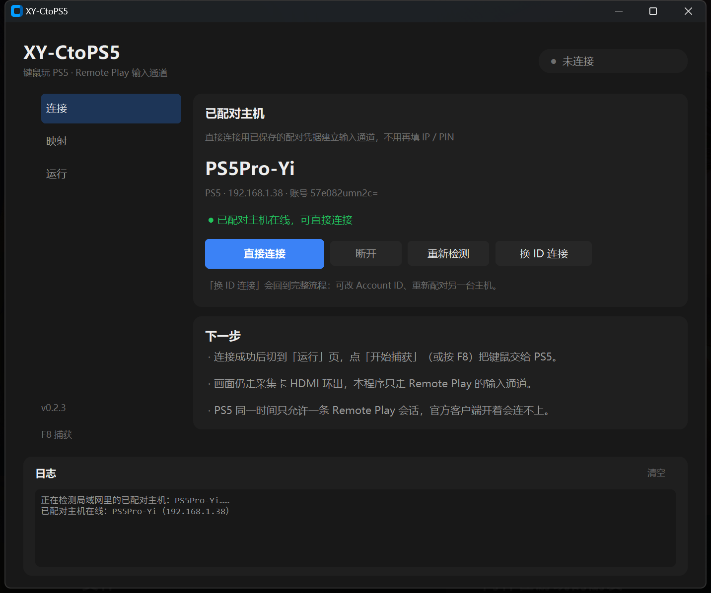
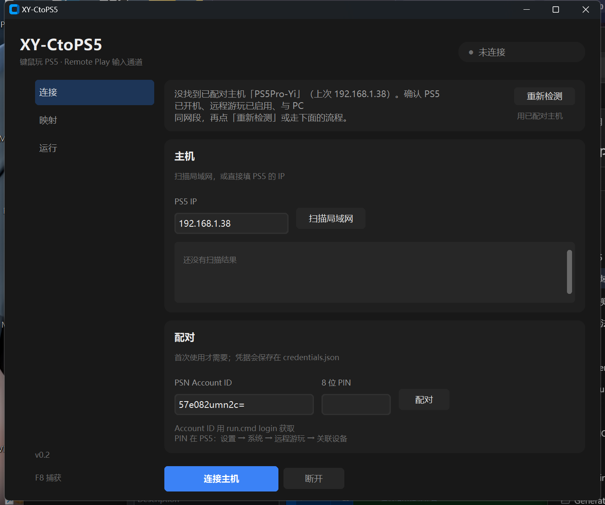

# 连接逻辑（已配对主机一键连接）开发文档

## 一、这个功能在做什么

把「连接 PS5」拆成两条路：

- **没配对过**：和以前一样，走完整流程——填 IP / 扫描局域网 / 填 Account ID + PIN / 配对 / 连接主机；
- **配对过**：程序记住上次那台主机（`credentials.json`），启动时自动检测它是否还在当前局域网：
  - 在 → 停在「快捷连接」页，点 **直接连接** 一个按钮就能建立输入通道；
  - 不在 → 自动回到完整流程页，顶部说明原因，可 **重新检测** 或重新配对。

判定"连过没有"的唯一依据是 `credentials.json` 里有没有可用的主机地址与注册档（`profiles`），
不新增任何配置文件字段。

## 二、两套视图与状态

| 视图 | 什么时候出现 | 内容 |
|---|---|---|
| 完整流程 `full` | 没配对过；或检测不到主机 / 检测出错；或用户点了「换 ID 连接」 | 主机卡片（IP + 扫描）、配对卡片（Account ID + PIN）、连接 / 断开按钮 |
| 快捷连接 `quick` | 已配对且检测中 / 检测到在线 / 已连接 | 主机名 + 类型/IP/账号、状态行、直接连接 / 断开 / 重新检测 / 换 ID 连接 |

检测状态（`connect_flow.py` 里的常量）：

| 状态 | 含义 | 视图 |
|---|---|---|
| `checking` | 正在检测局域网 | quick |
| `online` | 已配对主机在线，可直接连接 | quick |
| `offline` | 局域网里没有这台主机 | full（带提示条） |
| `error` | 检测本身失败（超时 / 网络异常） | full（带提示条） |
| `unpaired` | 没有可用凭据 | full（无提示条） |





## 三、关键代码位置

| 位置 | 职责 |
|---|---|
| `ps5kbm/connect_flow.py` | 纯逻辑：凭据摘要 `PairedConsole`、视图选择 `initial_view` / `view_for_state`、按钮可用性与文案 `describe` / `full_notice` |
| `ps5kbm/connect_ui.py` | 连接页骨架、快捷视图、两套视图的统一渲染入口 `render` |
| `ps5kbm/connect_full_ui.py` | 完整流程视图（主机 / 配对 / 连接断开）与提示条 |
| `ps5kbm/probe.py` | 探测已配对主机是否在线：`probe_console` → `ProbeResult` |
| `ps5kbm/_deps.py` | 在 import `playdirector` 之前注入 `vendor/netifaces.py` 兼容层（`bridge` 与 `probe` 共用） |
| `ps5kbm/app.py` | 编排：`_start_probe` / `_on_probe_finished` / `_apply_probe_result` / `_apply_probe_identity` / `_quick_connect` / `_switch_account` / `_use_quick_view` |
| `tests/test_connect_flow.py` | 视图选择、各状态按钮可用性、提示文案 |
| `tests/test_probe.py` | 在线 / 离线 / 换 IP / 超时 / 异常（假 controller，不联网） |

## 四、工作原理

### 1. 检测（不建立会话）

`probe.probe_console()` 复用 playdirector 的 `ConsoleController.status()`：

1. 向 `credentials["device_ip"]` 请求主机状态（DDP 只读）；
2. 不通时 `scan()` 广播扫描局域网，按 `host-id` 找回同一台主机（PS5 重启换 IP 的常见情形），
   验证身份后采用新地址；
3. 顺手迁移凭据格式，`controller.credentials` 里就是新地址。

全程只读身份，不创建 Remote Play 会话，所以不会和正式连接抢 PS5 唯一的那条会话。
外层用 `asyncio.wait_for(..., 20s)` 兜底（`status()` 最坏约 5+3+5 秒）。

### 2. 线程模型

探测跑在 app 已有的 asyncio 后台线程里；结果通过 `_ui_queue`（`kind="probe"`）回主线程，
由 `_poll_events` 调 `_apply_probe_result`。**后台线程不碰 Tk**，窗口关闭时结果最多进队列、不会炸。

### 3. 状态流转

```
启动
 ├─ 无凭据 → 完整流程（连接按钮置灰，先配对）
 └─ 有凭据 → 快捷视图(checking)
      ├─ 探测 online  → 快捷视图（直接连接可用）
      ├─ 探测 offline → 完整流程 + 提示条（重新检测 / 用已配对主机）
      └─ 探测 error   → 完整流程 + 提示条；快捷视图里「直接连接」仍然可用
完整流程配对成功 → 刷新已配对主机 → 快捷视图(online)
直接连接 / 连接主机 → _connecting=True（按钮置灰）
 ├─ 成功 → 快捷视图（已连接，断开可用）
 └─ 失败 → 快捷视图显示原因，允许重试（弹窗沿用原逻辑）
断开 → 回快捷视图（配对过）/ 完整流程（没配对）
```

检测出错（超时、本地 DDP 端口被占）并不代表主机连不上，所以 `connect_flow.describe` 在
`STATE_ERROR` 下把 `can_connect` 置为 True 并在状态行写「仍可尝试直接连接」——
以前这里会禁用一个按钮，用户只能先重测、再等最多 20 秒。

**断开是异步的**：`app._disconnect` 立刻更新界面（按钮置灰、回快捷视图），
把会话关闭丢给 asyncio 线程（`_close_session` + `_closing` 标志），界面不再卡最多 8 秒；
重连时 `_connect_async` 先等 `_closing` 归零，避免 PS5 上残留两条会话。
断开同时会 `InputSource.stop()`，释放 F8 全局热键与钩子 —— 否则断开后按 F8 会进入一个
没有会话的捕获态（覆盖层铺满屏幕、鼠标被藏起来）。界面层 `_apply_capture_state` 还有一道守卫：
没有 `_bridge` 时拒绝进入捕获并把输入层状态退回去。

用户点过「换 ID 连接」后，检测结果不会再把人从完整流程拽回快捷视图（`_manual_full` 标记）；
点「用已配对主机」或检测到离线后该标记复位。

### 4. IP 变化

探测发现主机换了 IP（`ProbeResult.ip_changed`）时，`_apply_probe_identity` 会把迁移后的凭据写回
`credentials.json`，并同步 `config.json` 的 `ps5_host`，下次启动直接用新地址。

## 五、依赖关系

- `app → {connect_ui, probe, bridge, config}`；
- `connect_ui → {connect_flow, theme, ui_widgets}`；
- `connect_flow` 不依赖 IO / Tk / 网络，可直接单测；
- `probe → {_deps, playdirector}`；`bridge → {_deps, playdirector, pyremoteplay, config}`。

协议与发现逻辑都来自 playdirector / pyremoteplay（GPL-3.0），本项目只做适配，不自己发 DDP 包。

## 六、怎么扩展

### 改文案 / 按钮可用性

只改 `connect_flow.describe()` 与 `full_notice()`，界面层不用动。

### 新增一种检测状态

1. `connect_flow.py` 加常量；
2. `view_for_state()` 决定它落在哪个视图；
3. `describe()` 里补文案与 `can_*`；
4. `app._apply_probe_result()` 里赋这个状态；
5. `tests/test_connect_flow.py` 补用例。

### 支持多台主机收藏

把 `PairedConsole` 列表化（数据放 `config.json` 的 `consoles` 数组），快捷视图加一个下拉/列表，
`_switch_account` 旁边加「添加主机」。探测按每台主机分别调用 `probe_console` 即可。

### 主机在待机时自动唤醒

`ConsoleController.wake()` 是现成 API；在 `describe()` 里给离线状态加一个 `can_wake`，
`app` 里加一个按钮回调调用 `wake()` 即可。注意唤醒前仍要先 `status()` 确认主机身份。

### 调整检测超时

改 `probe.DEFAULT_TIMEOUT`（默认 20 秒）。探测是后台任务，不会阻塞界面。

## 七、验证

- 单元测试：`python -m unittest discover -s tests`（`test_connect_flow.py` / `test_probe.py`）；
- 界面：用假探测结果分别跑「在线 / 离线 / 已连接 / 无凭据」四种状态截图确认；
- 实机需自行确认：真实 DDP 检测耗时、在线直接连接、PS5 换 IP 后自动找回。
