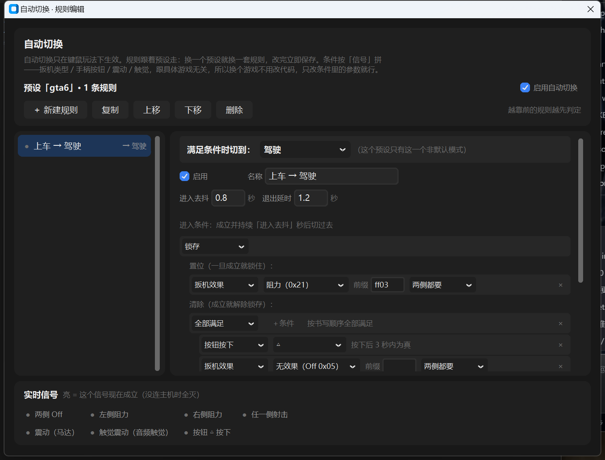

# XY-CtoPS5 v0.4.0 更新说明

> 一句话：**自动切模式变成一张可编辑的规则表**——条件按信号类型拼（扳机类型 / 手柄按钮 /
> 震动 / 触觉），一个预设 = 一个游戏 = 一套键位 + 一套规则，换游戏只改参数、不改代码。
> 顺手把编辑面板 1 秒级的卡顿、拖窗口弹回、自动切换排查日志一起收拾了。
> **手柄玩法保持原样**：这一版没碰手柄链路（文件一行未改，见第六节）。

---

## 一、自动切模式：从「固定信号」到「规则表」

### 之前是什么样

- 每个模式配一个「进入信号」和一个「退出信号」，可选项写死在代码里：
  `两侧开车特征` / `交互键按下` / `震动` / `触觉`；
- 「开车特征」是 GTA6 专用的一条判断（`0x21 FF 03` + 两侧），换个游戏或者换个参数就得改代码；
- 「交互键」靠配置里的 `vehicle_key` 写死某个键盘键，和按键映射是两份真相，改绑就静默失效。

### 现在是什么样

一条规则 = **条件树 + 目标模式 + 独立退出条件**，可以新建 / 复制 / 上下挪 / 删 / 停用，
全部在**映射页「自动切换」→「编辑规则…」**弹出的面板里改：



映射页第三行就是它的入口：`自动切换 ☑启用 · N 条规则 → 「驾驶」 · [编辑规则…]`。

```
满足条件时切到：[驾驶 ▾]        ← 第一行就是它，不用再猜规则往哪切
启用 ☑   名称 [上车 → 驾驶]
进入去抖 [0.8] 秒    退出延时 [1.2] 秒
进入条件：成立并持续「进入去抖」秒后切过去
  锁存   置位：[扳机效果 阻力 前缀 ff03 两侧]
         清除：[全部满足 按钮按下 △ / 扳机效果 无效果 两侧]
☐ 不自动退出（一直停在这个模式）
退出条件：成立并持续「退出延时」秒后回默认模式
  全部满足   按钮按下 △ / 扳机效果 无效果 两侧
读法：进入：锁存[...]；退出：(...)
```

- 左侧规则列表，右上角「＋新建 / 复制 / 上移 / 下移 / 删除」；
- 底部一排**实时信号灯**：亮 = 这个信号现在成立；规则行上也有灯（绿=条件成立、
  蓝=当前模式是它切的、黄=手动切走后被压住）；
- 改完立即保存到当前预设，**改完立刻生效**，不用重启。

### 能拼什么

| 节点 | 含义 |
|---|---|
| `扳机效果` | 类型（无效果 / 阻力 / 射击 / 自定义类型码）+ 参数前缀 hex + 作用侧（两侧 / 任一侧 / 左 / 右） |
| `按钮按下` | △ ✕ ○ □ 十字 L1 R1 L2 R2 L3 R3 OPTIONS SHARE PS 触摸板，按下后 3 秒内为真 |
| `震动` / `触觉` | 主机这一帧是否在震 / 在震 |
| `全部满足` / `任一满足` | 组合子条件（可嵌套） |
| `取反` | 条件不成立 |
| `持续 N 秒` | 成立并保持 N 秒 |
| `锁存` | 置位条件成立就锁住，清除条件成立才解除（**清除优先**） |
| `先后` | 先出现 A，之后出现 B |

GTA6 的「上车」就是普通一条：`扳机效果 = 阻力 + 前缀 ff03 + 两侧`。
换游戏只需要把前缀/类型改成新游戏的特征，不用改一行代码。

### 内置的 GTA6 驾驶规则

- 上车：主机把**两侧扳机同时**从「无效果 Off」改成「阻力 `FF 03`」→ 进「驾驶」；
  **完全不看键盘**——交互键 F（三角）同时用来开菜单、拾取，连按 `fffff` 一次都不会误判；
  不按键直接坐进车里也照样切；
- 下车：先按交互键（三角）**再**看到两侧 Off 才确认；
- 进车后**锁住**状态：主机只在变化时下发扳机效果，进车后可能很久没有新包，
  不会因为「没新数据」自己凉掉（这是上一版「进车一两秒又切回默认」的根因）；
- 切入时把正按着的移动键带过去：跑着按 F 上车，切换后 W 直接是油门，不用抬手重按；
- 手动按切换键切走时，会把正成立的规则压住，直到它冷掉一次，不会刚切完就被切回去。

## 二、排查日志：只说信号，不说故事

自动切换的现场日志（`ps5kbm.log`）改成中性措辞，并且不再刷屏：

```
扳机信号：两侧无效果 Off → 两侧阻力 FF03（L=21ff030000000000000000 R=21ff030000000000000000）
```

最近 8 帧原始扳机块从 INFO 降到 DEBUG（排查时把日志级别开到 DEBUG 再复现）。
「该切没切」先看有没有这一行：有 = 信号到了、去看规则条件；没有 = 主机没下发带阻力的扳机块。

## 三、卡顿：编辑规则不再点一下卡一秒

量出来的账（都在界面线程，就是你能感觉到的卡顿）：

| 操作 | 改前 | 改后 |
|---|---|---|
| 规则面板整页重画 | 1140 ms | 645 ms |
| 加一个子条件 | ~1100 ms | **122 ms** |
| 删一个子条件 | ~1100 ms | **244 ms** |
| 改前缀 / 按钮 / 秒数 | ~1100 ms | **~0 ms** |
| 映射列表重建（每次切模式都触发） | 771 ms | 67 ms |

两个根因：

1. `CTkOptionMenu._draw()` 末尾每次都会调 `canvas.update_idletasks()`，整块重建时等于把
   整棵界面排空几十遍（O(n²)）；现在批量重建期间屏蔽它，结束统一排一次；
2. 重建粒度太粗——改一个前缀也要销毁重建 193 个控件；现在增/删/换类型只重画那一个分组，
   纯数据改动只刷新底部「读法」一行。

## 四、拖窗口弹回

Windows 在拖拽过程中只要**激活窗口变了**，就会取消整次拖动、把窗口退回起点。
覆盖层原来每 800ms 无条件抢一次焦点，正好会撞上；现在只在「前台确实是别的程序」且
「没有按着鼠标键」时才抢焦点。同时界面里的长卡顿被压到几十毫秒，不会再把拖拽拖进「未响应」。

## 五、兼容与迁移

- 旧配置（更早的 `auto_signal` / `auto_leave`、内联 `rules`）**加载时自动迁移**到新写法；
- 删掉了 `vehicle_key`（交互键改成直接认手柄按钮）和 `ruleset`（规则回到预设里）；
- 按键预设里的 `controller` 段（陀螺仪 / 震动 / 自适应扳机 / 直通）**没有任何改动**。

## 六、手柄玩法：这一版没有动

- 手柄链路的文件一行未改：`controller_ui.py` / `dualsense.py` / `haptics_usb.py` /
  `feedback.py` / `gyro.py` / `gyro_calib_ui.py` / `bridge.py` / `input_source.py`；
- 自动切换、全屏透明覆盖层、键鼠钩子只在**键鼠玩法**下存在：手柄玩法不创建它们、不判定规则；
- `tuning.json` 不含手柄/陀螺仪数据，`config.json` 的 `controller` 段原样写回，规则编辑的
  每次落盘不会覆盖陀螺仪校准；
- 11 条玩法隔离单测（`tests/test_mode_isolation.py`）全过。

## 七、已知限制

- 点左侧**换一条规则**仍需 ~0.6 秒（整棵条件详情要重建），下一步按需分块渲染；
- 窗口最小尺寸锁在默认的 940×760，**不能拖小**（固定布局不滚动，缩了会裁内容）；
- 拖窗口弹回只在用户机器上偶发，本机用程序化拖拽（含连上主机后的完整输入栈）没能复现，
  已修最可能根因；如果还会遇到，把 `ps5kbm.log` 发出来。

## 八、验证情况

- 单元测试 **372 个全绿**；
- 真实界面冒烟：加子条件 → 删子条件 → 换类型 → 改前缀 → 加规则 → 删规则 → 选中，
  逐项断言「数据与画面行数一致」；
- 性能：上表由 `tools/bench_ui_rebuilds.py`、`tools/bench_rules_refresh.py` 复现；
- 实机：GTA6 上车 / 下车自动切换正常，连按交互键不误判。

## 九、升级与使用提示

1. 直接覆盖安装即可，`config.json` 会按新结构自动迁移；
2. 键鼠玩法：映射页第三行「自动切换」→ 勾「启用」→「编辑规则…」；
3. 调规则时先看底部实时信号灯：灯不亮说明这个信号现在不成立（没连主机时全灭）；
4. 换游戏：复制一份预设 → 改键位 → 把规则里的扳机前缀/类型换成新游戏的特征。
